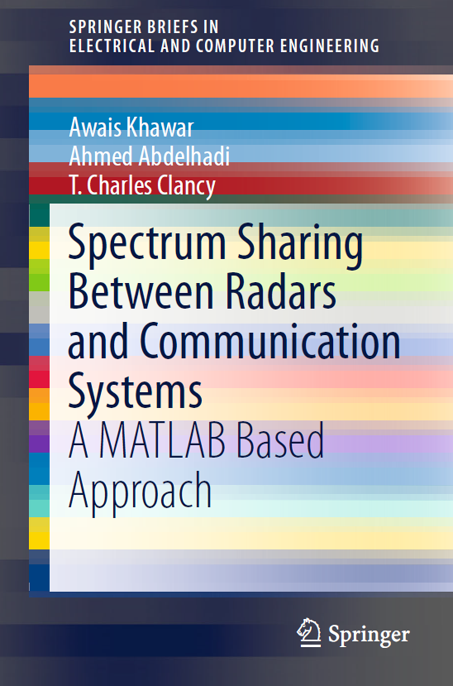

# Spectrum Sharing Between Radars and Communication Systems

Based on Projection Spectrum Sharing Method:
System Model: Radar model, target model/channel, signal model, orthogonal waveforms, communication system, interference channel, cooperative radio frequency environment, radar-cellular system spectrum sharing, architecture, spectrum sharing algorithm for small MIMO radar, performance metrics, interference channel selection algorithm, modified null space projection (NSP) algorithm, simulation results, large MIMO radar spectrum sharing algorithm, projection matrix, spectrum sharing and projection algorithm.
Cooperative Multi-Input Multi-Output Radar and Cooperative Multi-Input Multi-Output Cellular System:
Radar/CoMP system spectrum coexistence model, coordinated multi-point (CoMP) system, clustering algorithm, colocated MIMO radar, spectrum coexistence scenarios, spectral coexistence signal design, radar precoding to reduce interference, cooperative radar precoding design, CoMP signal design to reduce interference, cooperative CoMP signal design, impact of ship motion on radar precoding design, two operating modes and radar PRI, spectrum sharing algorithm, optimal cluster selection algorithm, small singular value space projection (SSVSP) algorithm, theoretical performance analysis of radar precoding, simulation results, interference cancellation precoding performance analysis, precoding performance analysis, information exchange performance analysis, interference mitigation mode, cooperative mode, several functions of the two modes.
Overlapping Multi-Input Multi-Output (MIMO) Radar and Multi-Input Multi-Output (MIMO) Cellular System:
Coexistence system models, radar models, communication system models, coexisting channel models, key assumptions, ground-based multi-input multi-output radar, overlapping multi-input multi-output radar, performance metrics for overlapping multi-input multi-output radar, beampattern improvements, SNR gain improvements, optimal subarray size for overlapping multi-input multi-output radar, spectrum sharing algorithm centered around the radar, spatial projection (NSP), projection matrix, new strategic planning assumptions and constraints, simulations and results, conclusions, Overlapped-MIMO main module., uplink beamforming matrix, virtual steering vector, number of subarrays.

## Images

<!-- PAYMENT_BLOCK -->

## Get this dataset

- Payment link (Stripe): [Buy now](https://buy.stripe.com/3cs8yP7sY87d0vu9AB)
- Payment QR code: 

<!-- /PAYMENT_BLOCK -->
